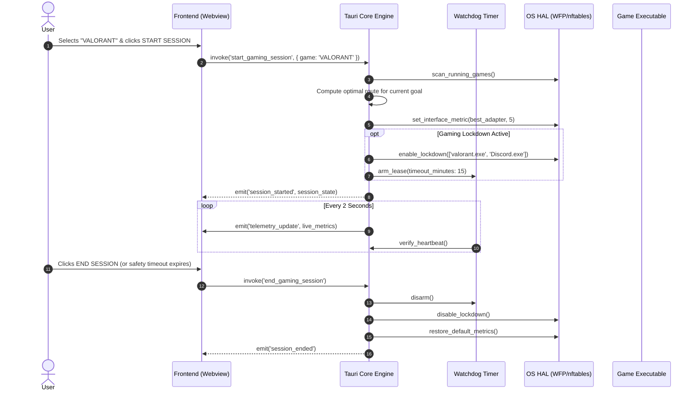

# System Architecture — Nexus Net

---

## 1. High-Level Architecture

Nexus Net employs a layered, decoupled architecture separating the presentation layer from the performance-critical and OS-privileged networking core.

```
┌────────────────────────────────────────────────────────────────────────┐
│                          PRESENTATION LAYER                            │
│           Embedded Webview (HTML5 / CSS Tokens / Vanilla JS)           │
│        • Dashboard HUD              • Gaming Mode / Allowlist          │
│        • Candidate Route Rankings   • Diagnostics & Adapter Center     │
└───────────────────────────────────▲────────────────────────────────────┘
                                    │ IPC (Tauri Commands / Events)
┌───────────────────────────────────▼────────────────────────────────────┐
│                       NEXUS CORE (Rust / Tauri)                        │
│                                                                        │
│   ┌─────────────────────┐  ┌─────────────────────┐  ┌──────────────┐  │
│   │    Probe Engine     │  │   Scoring Engine    │  │ Game Watcher │  │
│   │ (ICMP/UDP telemetry)│  │ (Objective weights) │  │(Process scan)│  │
│   └──────────┬──────────┘  └──────────┬──────────┘  └───────┬──────┘  │
│              │                        │                     │         │
│              ▼                        ▼                     ▼         │
│   ┌────────────────────────────────────────────────────────────────┐  │
│   │              OS Hardware Abstraction Layer (HAL)               │  │
│   │        trait NetworkManager    │    trait FirewallManager      │  │
│   │        trait ProcessWatcher    │    trait AdapterTuner         │  │
│   └───────────────────────────────┬────────────────────────────────┘  │
└───────────────────────────────────┼────────────────────────────────────┘
                                    │ Native OS System Calls
                   ┌────────────────┴────────────────┐
                   ▼                                 ▼
┌──────────────────────────────────────┐ ┌───────────────────────────────┐
│           LINUX PLATFORM             │ │       WINDOWS PLATFORM        │
│ • Netlink (rtnetlink)                │ │ • Win32 IP Helper (IPHLPAPI)  │
│ • nftables (transient ruleset)       │ │ • Windows Filtering Platform  │
│ • /proc & cgroup v2 tracking         │ │ • Toolhelp32 / WMI snapshot   │
│ • sysfs & ethtool                    │ │ • NetAdapter PowerShell / WMI │
└──────────────────────────────────────┘ └───────────────────────────────┘
```

---

## 2. Core Subsystems

### 2.1. Probe & Telemetry Engine
* **Purpose:** Continuously monitor real round-trip time (RTT), latency jitter, and packet loss across every candidate interface without causing link congestion.
* **Mechanism:**
  * Uses unprivileged UDP Echo / DNS query probes (to public low-latency endpoints: Cloudflare `1.1.1.1`, Google `8.8.8.8`, and major gaming datacenters) and raw ICMP when permissions permit.
  * Measures rolling sample window ($N = 30$ samples) to compute:
    * **Latency:** Mean RTT in milliseconds.
    * **Jitter:** Standard deviation of RTT ($\sigma = \sqrt{\frac{1}{N}\sum(x_i - \bar{x})^2}$).
    * **Loss Rate:** Ratio of timed-out packets to total packets sent ($L = \frac{Loss}{Total} \times 100\%$).

### 2.2. Decision & Scoring Engine
* **Purpose:** Convert raw telemetry into a normalized score ($0 - 100$) for each available network connection based on the user's selected optimization goal.
* **Scoring Formulas:**
  * **Latency Score ($S_{lat}$):**
    $$S_{lat} = \max(0, 100 - (2 \times \text{RTT}) - (3 \times \text{Jitter}) - (30 \times \text{Loss}))$$
  * **Stability Score ($S_{stab}$):**
    $$S_{stab} = \max(0, 100 - (10 \times \text{Jitter}) - (40 \times \text{Loss}))$$
  * **Throughput Score ($S_{tp}$):**
    $$S_{tp} = \min(100, \frac{\text{Capacity Mbps}}{10})$$
  * **Composite Objectives:**
    * *Lowest Latency Goal:* $\text{Score} = S_{lat}$
    * *Balanced Gaming Goal:* $\text{Score} = (0.55 \times S_{lat}) + (0.30 \times S_{stab}) + (0.15 \times S_{tp})$
    * *Maximum Throughput Goal:* $\text{Score} = S_{tp}$
    * *Maximum Stability Goal:* $\text{Score} = S_{stab}$

### 2.3. Route Metric Controller
* Rather than intercepting and rerouting individual IP packets at the user level (which adds latency), Nexus Net manipulates **Interface Routing Metrics** on the host.
* By assigning a lower routing metric (higher priority) to the preferred interface (e.g. Metric 5 for 5 GHz Wi-Fi vs Metric 25 for Ethernet), the OS kernel automatically routes all default internet and game traffic through the winning adapter.

### 2.4. Gaming Lockdown (Firewall Controller)
* **Linux Implementation (`nftables`):**
  Creates a transient table with priority `-150`:
  ```nft
  table inet nexus_lockdown {
      chain egress_filter {
          type filter hook output priority -150; policy drop;
          # Allow loopback & local DNS
          oif "lo" accept
          udp dport 53 accept
          # Allow verified game cgroup or socket owners
          meta skuid $ALLOWED_UID accept
          # Allow established traffic
          ct state established,related accept
      }
  }
  ```
* **Windows Implementation (WFP):**
  Uses the Windows Filtering Platform (WFP) with an ephemeral sublayer:
  * Adds an outbound filter at `FWPM_LAYER_ALE_AUTH_CONNECT_V4`.
  * Blocks all connections by default *except* where `FWPM_CONDITION_ALE_APP_ID` matches the path of allowlisted executables (e.g., `valorant.exe`, `Discord.exe`).
  * Bound to a dynamic session (`FWPM_SESSION_FLAG_DYNAMIC`), ensuring that if Nexus Net exits, the OS immediately releases all firewall blocks.

### 2.5. Process & Game Watcher
* Periodically inspects running system processes against a local database of known games and launchers (`Steam`, `RiotClient`, `EpicGamesLauncher`, `cs2.exe`, `valorant.exe`).
* Triggers profile transitions automatically when game launches are detected (if Auto-Detect is enabled).

---

## 3. Hardware Abstraction Layer (HAL) Trait Definitions

To ensure complete cross-platform portability between Linux and Windows, all platform-specific logic is implemented behind Rust traits:

```rust
use async_trait::async_trait;
use serde::{Deserialize, Serialize};

#[derive(Debug, Clone, Serialize, Deserialize)]
pub struct NetworkAdapter {
    pub id: String,
    pub name: String,
    pub ip_addresses: Vec<String>,
    pub gateway: Option<String>,
    pub is_up: bool,
    pub is_wireless: bool,
    pub current_metric: u32,
    pub link_speed_mbps: u64,
}

#[derive(Debug, Clone, Serialize, Deserialize)]
pub struct TelemetryReading {
    pub latency_ms: f64,
    pub jitter_ms: f64,
    pub packet_loss_pct: f64,
}

/// Abstract contract for managing network interfaces and routing
#[async_trait]
pub trait NetworkManager: Send + Sync {
    async fn enumerate_adapters(&self) -> Result<Vec<NetworkAdapter>, String>;
    async fn set_interface_metric(&self, adapter_id: &str, metric: u32) -> Result<(), String>;
    async fn get_default_gateway(&self, adapter_id: &str) -> Result<String, String>;
}

/// Abstract contract for strict Gaming Lockdown firewall enforcement
#[async_trait]
pub trait FirewallManager: Send + Sync {
    async fn enable_lockdown(&self, allowed_executables: &[String]) -> Result<(), String>;
    async fn disable_lockdown(&self) -> Result<(), String>;
    async fn emergency_flush(&self) -> Result<(), String>;
    async fn is_lockdown_active(&self) -> bool;
}

/// Abstract contract for observing running game processes
#[async_trait]
pub trait ProcessWatcher: Send + Sync {
    async fn scan_running_games(&self, known_game_exes: &[String]) -> Result<Vec<String>, String>;
}

/// Abstract contract for querying and applying Wi-Fi adapter properties
#[async_trait]
pub trait AdapterTuner: Send + Sync {
    async fn get_advanced_properties(&self, adapter_name: &str) -> Result<Vec<AdapterProperty>, String>;
    async fn set_property(&self, adapter_name: &str, key: &str, value: &str) -> Result<(), String>;
}
```

---

## 4. Session Runtime Flow


